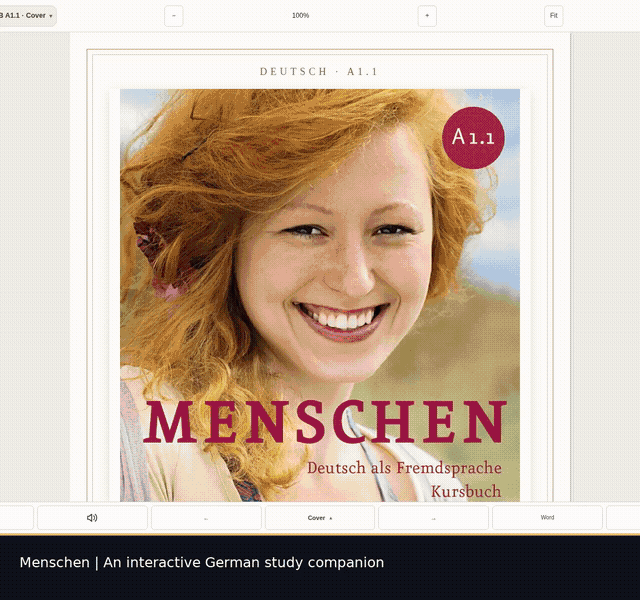

# Menschen | Interactive German A1 Study Companion

[Open the study site](https://menscheny.pages.dev/)

An interactive companion to the Menschen A1.1 and A1.2 Kursbuch and Arbeitsbuch, with page navigation, exercises, German audio and Egyptian-Arabic explanations. Intended for study with Hinawi's students.

## Reader walkthrough



[Watch or download the MP4 recording](docs/demo/walkthrough.mp4). Two-voice Egyptian-Arabic narrated walkthrough, recorded from the live reader on November 15, 2026.

## Features

- Kursbuch and Arbeitsbuch navigation across A1.1 and A1.2.
- Page-flip reader, zoom/fit controls, library navigation and original-page viewer.
- Interactive exercises with answer feedback and browser-saved work.
- Tap/select text for Egyptian-Arabic meanings and German pronunciation.
- Original listening tracks where supplied, recorded pronunciation and a network TTS fallback for supported missing clips.
- A portable desktop packaging workflow, described below.

## Stack

React, TypeScript, Vite and Tailwind CSS, with lesson-specific styles and content adapters. Cloudflare Pages serves the built reader; `functions/api/tts.js` supplies the optional network pronunciation route. The checked-in frontend does not require an account to read the book. Additional account work is separate from this documented reader build.

## Develop

Use a current Node.js LTS release compatible with the installed Vite version.

```bash
npm install
npm run dev          # http://127.0.0.1:5173
npm test             # content checks
npm run test:react   # component foundation checks
npm run typecheck
npm run build        # output in dist/
npm run preview
```

`npm run test:react:all` runs the broader React check collection. These commands describe the available checks; the walkthrough is not proof that every book page or exercise has been audited.

## Repository map

- `src/`: reader components, native lesson UI, adapters, meanings, exercise logic and persistence.
- `assets/`: images, fonts and audio.
- `functions/`: Pages Function for optional network pronunciation.
- `tests/`: content and component checks.
- `desktop/`, `scripts/build-desktop.mjs`: portable desktop packaging.
- `docs/screenshots/`: still previews of the reader.

## Hosting and audio

The Vite configuration emits the SPA and legacy-route metadata. Cloudflare builds use an audio subset to stay within hosting file limits, with an emitted manifest and a TTS fallback for supported text. Local builds may include more recorded assets. Network pronunciation is not available without its server route and internet access.

## Rights and audience

The original books, artwork and recordings belong to **Hueber Verlag** and their respective owners. This project is an educational study companion, not an official publisher product or a grant to redistribute the original material. The site is intended for students and uses search-engine exclusion; `noindex` is not access control. Keep source PDFs and private course material out of new public uploads.

## Offline desktop app (Windows, portable)


A portable Windows build of the whole book - no installer, no admin rights, no
internet. It bundles the full site (every page, image, font and all ~21,700
audio clips) plus local copies of the 24 Film-Stationen video clips, wrapped in
a small Electron shell that serves the files locally. Answers and progress are
saved on the computer, exactly like the site saves them in the browser.

Build it from the repo root (Node 20+ and Python 3 needed):

```
npm install
npm run build:desktop
```

The result is `build/menschen-windows-portable.zip` (and the ready folder
`build/Menschen-windows/`): unzip anywhere and double-click `Menschen.exe`.
The build also produces Full HD (1920x1080) versions of the clips with ffmpeg.
Note the Menschen film only exists in standard definition (the uploads top out at
480p), so these are high-quality lanczos upscales, not true HD masters; the audio
track is the original. The Electron runtime and the video clips are cached under
`desktop-cache/`, so rebuilding after a site update only redoes the site build and
repacks - run the same command again after pulling the latest `main`.
