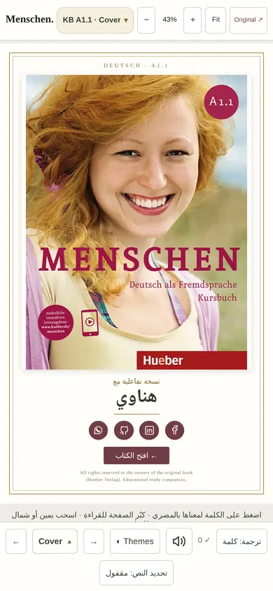
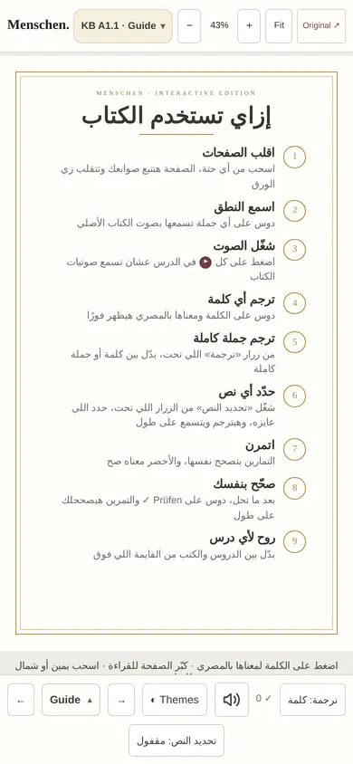
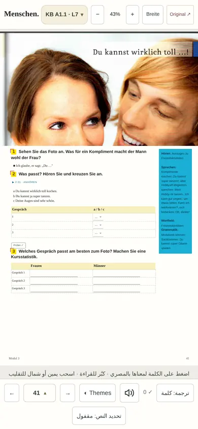
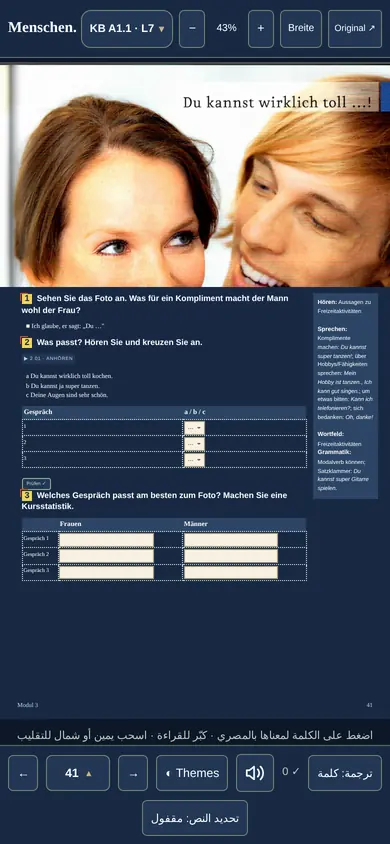
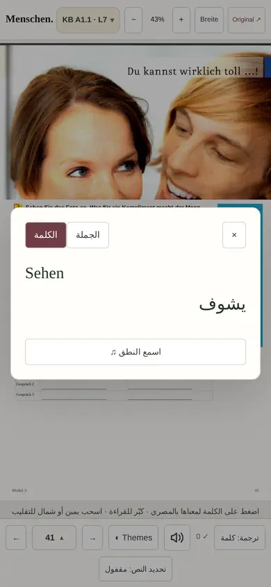
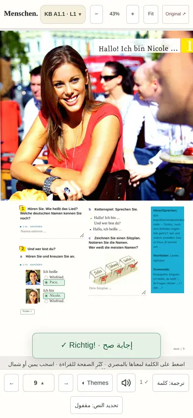
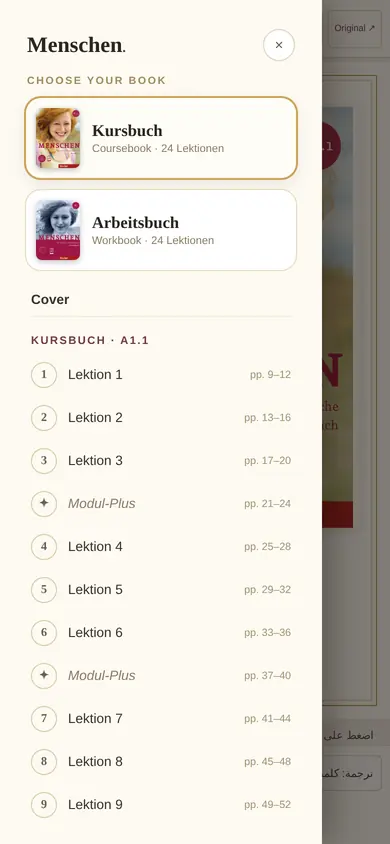

# Menschen. — the interactive German coursebook

The Hueber **Menschen A1** books, alive in the browser: flip the real pages, hear the
original audio, and tap any word or sentence for its meaning in Egyptian Arabic.

**Live:** https://menscheny.pages.dev

## What's inside

- **Both books, both levels** — Kursbuch A1.1 + A1.2 and Arbeitsbuch A1.1 + A1.2,
  24 lessons each, plus Modul-Plus pages.
- **Real page flip** — the book behaves like paper: drag from anywhere and the page
  follows your finger (powered by `page-flip`), with smooth SPA navigation between
  lessons, books, cover and guide.
- **Original audio** — the book's own CD tracks for every listening task, plus
  per-word and per-sentence pronunciation.
- **Tap-to-translate, Egyptian Arabic** — tap any word for its meaning بالمصري, or
  switch the translation mode from word to full sentence. A selection-lock button
  (تحديد النص) lets you select any passage and translate + hear it.
- **Self-checking exercises** — answer, press **Prüfen ✓**, and get instant feedback;
  correct answers turn green.
- **Ten reader themes** — light and dark palettes (Light, Paper, Sand, Dark, Forest,
  Burgundy, Ocean, Midnight, Slate, Plum), tuned for contrast in every theme.
- **Library sidebar** — jump between books, lessons, covers and the guide from one sheet.
- **Original viewer** — leaf through the printed pages as scanned, per book.
- **دليل الاستخدام** — an Egyptian-Arabic guide page (إزاي تستخدم الكتاب) built into every book.
- Answers, notes and reading progress are saved on the current device only.

## Screenshots

| Cover | Guide | Lesson | Lesson (Midnight theme) |
| --- | --- | --- | --- |
|  |  |  |  |

| Tap-to-translate | Prüfen self-check | Library |
| --- | --- | --- |
|  |  |  |

## Stack

React 19 · TypeScript · Vite 8 · `page-flip` · hand-tuned CSS (per-lesson stylesheets
+ a theme layer) · Playwright for visual checks. No backend, no accounts, no tracking.

## Develop

```bash
npm install
npm run dev        # http://127.0.0.1:5173
npm run build      # -> dist/
npm run preview    # serve the build locally
npm test           # content checks
npm run test:react # component foundation checks
npm run typecheck  # tsc --noEmit
```

## Project structure

- `*.html` (repo root) — one Vite entry per book/lesson route (26 routes).
- `src/` — the app: `components/` (book markup renderer, cover socials, reader themes,
  library nav), `lessons/*.json` (lesson markup as JSON node tuples), `meanings/`
  (tap-to-translate, selection controls), `adapters/` (per-book routing/persistence),
  `scan/` (original viewer + vocabulary), `exercises/`, `persistence/`.
- `assets/` — fonts, images, cover art, OG cards and the original audio.
- `themes.css`, `book.css`, per-lesson `*.css` — the visual layer.
- `tests/` — content and answer-key checks.

## Rights

All rights to the original book, audio and artwork belong to their owners
(**Hueber Verlag**). This is a personal, educational study companion: the site is
`noindex,nofollow,noarchive`, unlisted, and carries no ads, accounts or payments.

## Offline desktop app (Windows, portable)

A portable Windows build of the whole book - no installer, no admin rights, no
internet. It bundles the full site (every page, image, font and all ~21,700
audio clips) plus local copies of the 24 Film-Stationen video clips, wrapped in
a small Electron shell that serves the files locally. Answers and progress are
saved on the computer, exactly like the site saves them in the browser.

Build it from the repo root (Node 20+ and Python 3 needed):

```
npm install
npm run build:desktop
```

The result is `build/menschen-windows-portable.zip` (and the ready folder
`build/Menschen-windows/`): unzip anywhere and double-click `Menschen.exe`.
The Electron runtime and the video clips are cached under `desktop-cache/`, so
rebuilding after a site update only redoes the site build and repacks - run the
same command again after pulling the latest `main`.

## Author

Made by **Mohamed Alhinawi** · https://menscheny.pages.dev
