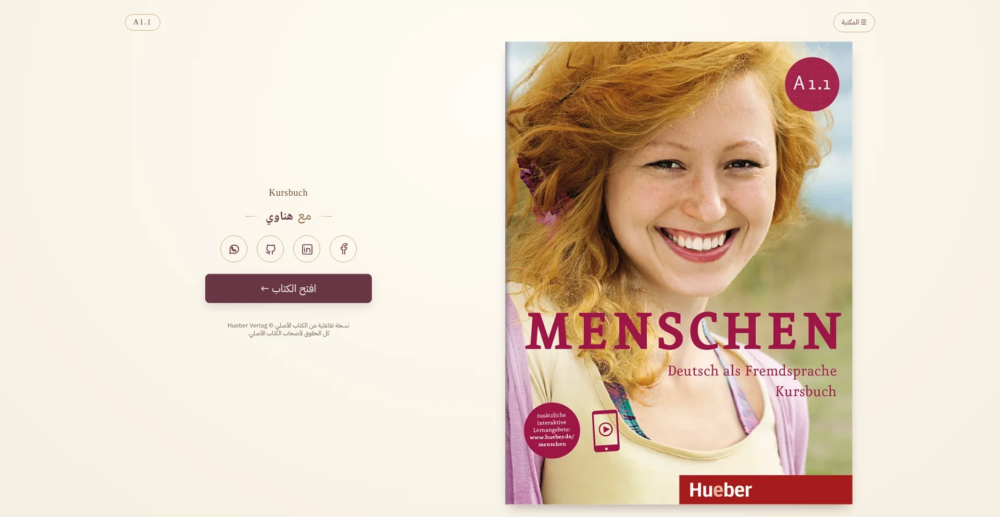
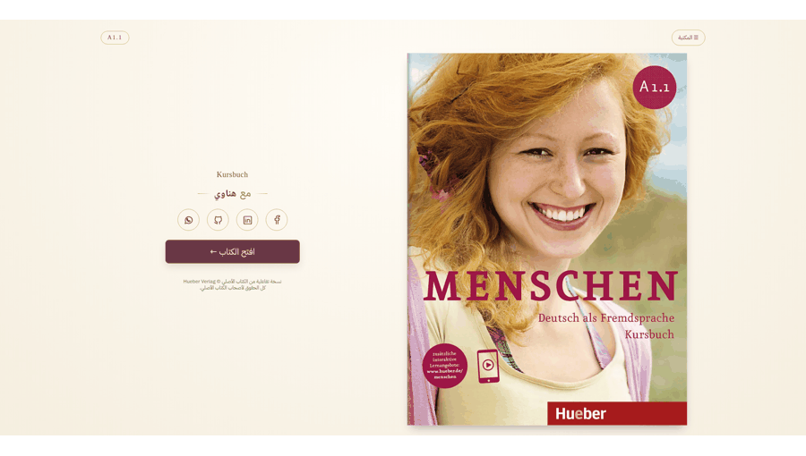
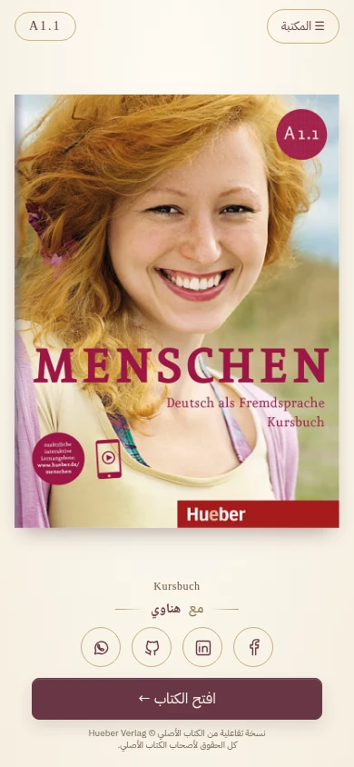
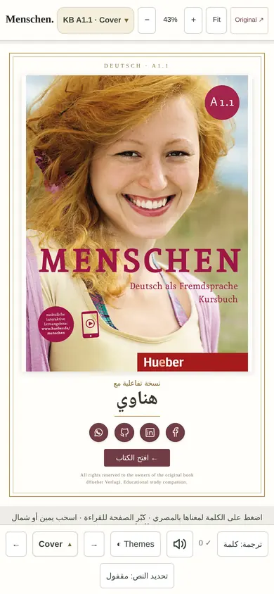
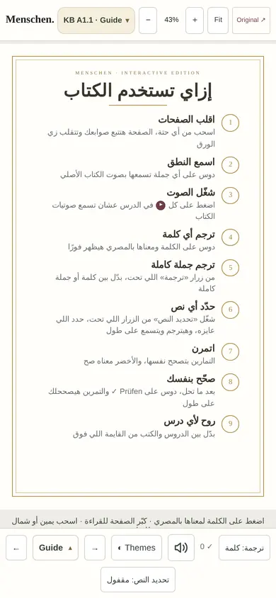
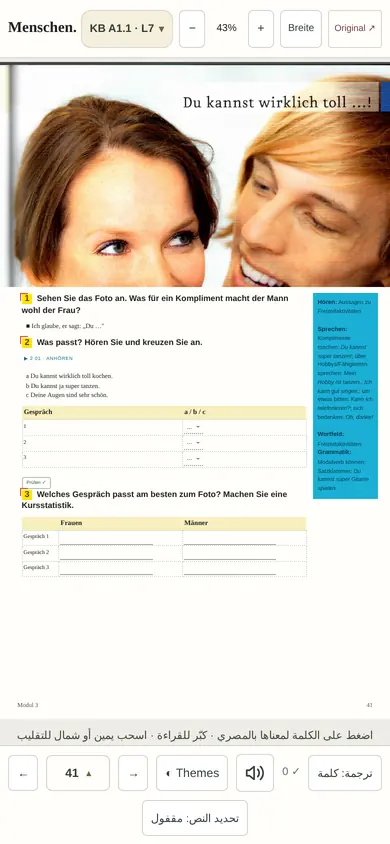
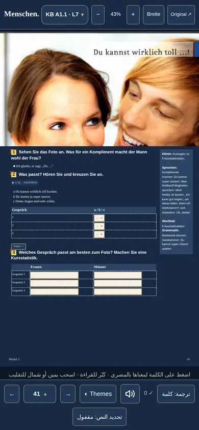
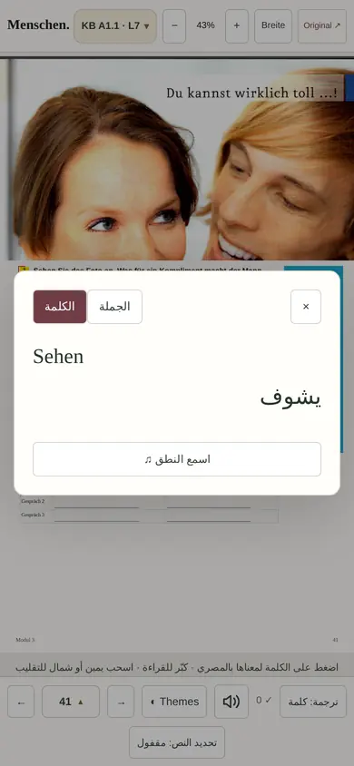
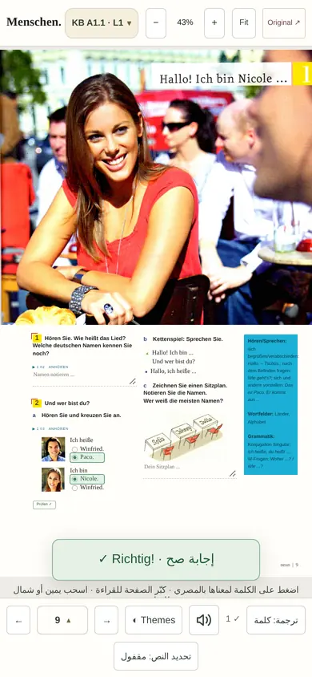
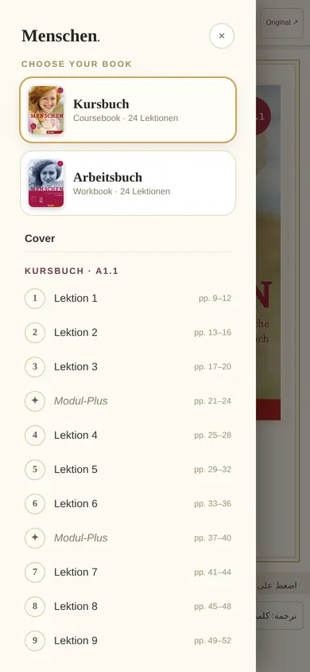

<div align="center">

# Menschen.

### The interactive German coursebook —بالعامية المصرية

The Hueber **Menschen A1** books, alive in the browser: flip the real pages, hear the
original audio, and tap any word or sentence for its meaning in Egyptian Arabic.

[](https://menscheny.pages.dev)
[](https://react.dev)
[](https://www.typescriptlang.org)
[](https://vitejs.dev)
[](https://pages.cloudflare.com)

[](https://menscheny.pages.dev)

**[Open the book →](https://menscheny.pages.dev)**

</div>

---

## Live preview

Captured from the current live site on 18 November 2026. The short GIF cycles through the book cover, library and first lesson. These are actual navigation captures, not generated screens.

[](https://menscheny.pages.dev/)

| Desktop | Mobile |
| --- | --- |
|  |  |

[Open lesson 1](https://menscheny.pages.dev/index.html#9) · [Open the book](https://menscheny.pages.dev/)

The screenshots show this project's interface. Rights to the underlying book artwork remain with Hueber Verlag; see [Rights](#rights).

## What's inside

- **Both books, both levels** — Kursbuch A1.1 + A1.2 and Arbeitsbuch A1.1 + A1.2,
  24 lessons each, plus Modul-Plus pages.
- **Real page flip** — the book behaves like paper: drag from anywhere and the page
  follows your finger (powered by `page-flip`), with smooth SPA navigation between
  lessons, books, cover and guide.
- **Original audio** — the book's own CD tracks for every listening task, plus
  per-word and per-sentence pronunciation. Clips beyond the bundle resolve through a
  speech endpoint, so every word on every page can be heard.
- **Tap-to-translate, Egyptian Arabic** — tap any word for its meaning بالمصري, or
  switch the translation mode from word to full sentence. A selection-lock button
  (تحديد النص) lets you select any passage and translate + hear it.
- **Self-checking exercises** — answer, press **Prüfen ✓**, and get instant feedback;
  correct answers turn green. Connect-the-line matching is drawn by hand, right on the page.
- **Accounts and leaderboard** — sign in with Google, pick an avatar, collect points
  and climb the class leaderboard.
- **Two UI languages** — full interface in Arabic (RTL) or English (LTR), remembered
  per visitor.
- **Ten reader themes** — light and dark palettes (Light, Paper, Sand, Dark, Forest,
  Burgundy, Ocean, Midnight, Slate, Plum), tuned for contrast in every theme.
- **Library sidebar** — jump between books, lessons, covers and the guide from one sheet.
- **Original viewer** — leaf through the printed pages as scanned, per book.
- **دليل الاستخدام** — an Egyptian-Arabic guide page (إزاي تستخدم الكتاب) built into every book.
- Answers, notes and reading progress are saved on the current device; points sync
  to the leaderboard once signed in.

## Screenshots

| Cover | Guide | Lesson | Lesson (Midnight theme) |
| --- | --- | --- | --- |
|  |  |  |  |

| Tap-to-translate | Prüfen self-check | Library |
| --- | --- | --- |
|  |  |  |

## Architecture

```
Browser (React 19 + TypeScript + Vite 8)
  ├─ Reader: page-flip engine, per-lesson stylesheets, theme layer
  ├─ Exercises: instant-feedback renderer, hand-drawn line matching
  ├─ Audio: bundled clips + manifest, speech fallback over HTTPS
  └─ API ──► Cloudflare Worker (Hono) ──► D1 (accounts, points, leaderboard)
```

- **Frontend** — one Vite entry per book/lesson route (26 routes); `src/components/`
  (book markup renderer, cover, reader themes, library nav), `src/lessons/*.json`
  (lesson markup as JSON node tuples), `src/meanings/` (tap-to-translate, selection
  controls), `src/adapters/` (per-book routing/persistence), `src/exercises/`.
- **Backend** — `backend/`, a Cloudflare Worker (Hono) exposing the auth, points and
  leaderboard API on `menscheny-api`, backed by a D1 database (`migrations/` in `backend/`).
- **Audio pipeline** — the Cloudflare build ships a prioritized clip bundle plus a
  manifest (`src/generated/cf-audio-manifest.json`); anything outside the bundle is
  served on demand so the site stays fast and under the platform file cap.
- **Assets** — fonts, images, cover art, OG cards and the original audio under `assets/`.

## Develop

```bash
npm install
npm run dev        # http://127.0.0.1:5173
npm run build      # -> dist/
CF_PAGES=1 npm run build   # Cloudflare bundle (prioritized audio + manifest)
npm run preview    # serve the build locally
npm test           # content checks
npm run test:react # component foundation checks
npm run typecheck  # tsc --noEmit
```

Backend:

```bash
cd backend
npm install
npx wrangler deploy                 # deploy the worker
npx wrangler d1 migrations list menscheny
```

## Offline desktop app (Windows, portable)

A portable Windows build of the whole book - no installer, no admin rights, no
internet. It bundles the full site (every page, image, font and all ~21,700
audio clips) plus local copies of the 24 Film-Stationen video clips, wrapped in
a small Electron shell that serves the files locally. Answers and progress are
saved on the computer, exactly like the site saves them in the browser.

Build it from the repo root (Node 20+ and Python 3 needed):

```
npm install
npm run build:desktop
```

The result is `build/menschen-windows-portable.zip` (and the ready folder
`build/Menschen-windows/`): unzip anywhere and double-click `Menschen.exe`.
The build also produces Full HD (1920x1080) versions of the clips with ffmpeg.
Note the Menschen film only exists in standard definition (the uploads top out at
480p), so these are high-quality lanczos upscales, not true HD masters; the audio
track is the original. The Electron runtime and the video clips are cached under
`desktop-cache/`, so rebuilding after a site update only redoes the site build and
repacks - run the same command again after pulling the latest `main`.

## Rights

All rights to the original book, audio and artwork belong to their owners
(**Hueber Verlag**). This is a personal, educational study companion: the site is
`noindex,nofollow,noarchive`, unlisted, and carries no ads or payments.

---

<div align="center">

Made with care by **Mohamed Alhinawi** · [menscheny.pages.dev](https://menscheny.pages.dev)

</div>
